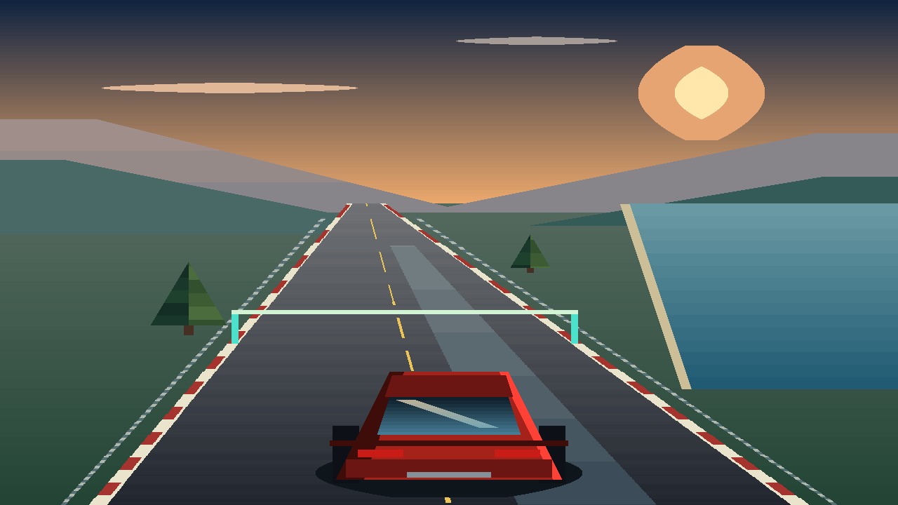

# Reverse Velocity — shader costero XI

El juego de carreras usa REgraphics con una nueva escena de carretera costera al
atardecer. `velocity/render.xi` calcula geometría, selección de materiales,
perspectiva, recorte y orden de capas. `palette.txt` contiene 256 colores
autorizados por el presentador. Android recibe XFS1 binario y presenta la imagen.



## Diseño visual implementado

- Cielo graduado, disco solar, halo, nubes y montañas por capas.
- Costa, mar, arcenes, guardarraíles y árboles que avanzan con la posición del
  vehículo. La fase del escenario depende de la posición, no del reloj de ticks.
- Asfalto graduado, brillo localizado, bordillos alternos y marcas con anchura
  que aumenta con la perspectiva.
- Carrocería con caras oscuras, base y luz, neumáticos, sombra de contacto,
  alerón, luces de freno y banda de reflejo sobre el cristal.
- Tres cámaras distintas: trasera, cercana y capó; cinco pinturas visibles en
  todas ellas. La vista de capó incluye carrocería y tablero.
- Arcos de los seis checkpoints calculados desde el progreso XI de la carrera.

Es un shader de materiales por regiones y una escena en perspectiva por
scanlines. El brillo y los reflejos son estilizados; esta versión no implementa
PBR, reflejos de geometría ni un mundo abierto. Los elementos visuales y el
código del juego son propios.

## Estructura y presupuesto

| Materiales | Uso |
| --- | --- |
| 0–63 | Cielo |
| 64–95 | Terreno |
| 96–127 | Asfalto |
| 128–157 | Cinco pinturas, seis tonos por pintura |
| 158–169 | Cristal |
| 170–185 | Mar |
| 186–201 | Montañas y vegetación |
| 202–228 | Troncos, bordes, luces, sombra, guardarraíles y checkpoints |
| 229–244 | Brillo de asfalto y reflejo del cielo |
| 245–255 | Tablero, franja del capó y detalles |

La fuente emite hasta 46 capas posibles en orden decreciente de profundidad.
El presentador admite un máximo de 48 regiones por fila, profundidad 1–100 y
una fila de fondo completa antes de cualquier detalle. XFS1 conserva el extremo
derecho inclusivo. Las calidades mantienen muestreo vertical 4, 2 y 1, con
anchos internos de presentación 320, 640 y 1280.

El render observa el mismo RVPC2 que la conducción. Los bytes 203, 204, 216 y
220–227 son scratch del candidato de render; su estado de retorno se descarta.
El circuito conserva su autoridad en `world.xi` e InverseMemory. La escena usa
la familia `framebegin`/`framespan`/`frameend` y ejecuta fuente XI mediante la API
genérica; no requiere otro renderer nativo específico del juego.

## Conducción y controles

El reloj de carrera espera a la primera aceleración. Una vez iniciada, continúa
aunque el coche se detenga y queda congelado al terminar. La resistencia a baja
velocidad conserva ahora el resto fraccionario entre ticks en dos bytes XI
(122–123): evita que la división entera elimine la desaceleración.

El botón de pausa o la tecla P detienen la programación de ticks sin acumular
tiempo pendiente. El HUD distingue preparado, carrera, pausa y meta; el cambio
de foco libera los controles. WASD/flechas conducen, espacio activa derrape y R
reinicia. Las reglas y el estado mantienen la ABI de nueve registros.

El ciclo de vida conserva la intención de ejecutar o detener el juego y un
único hilo de render. Si el cierre tarda más que la espera de pausa, reanudar
recupera el ciclo sin solapar dos trabajadores ni quedar congelado. Una nueva
superficie no puede reiniciar el juego mientras la actividad está pausada.

## Validación y coste

Pasaron 52 escenas deterministas: 45 combinaciones de calidad/cámara/pintura,
seis posiciones y una observación tras 40 ticks reales de conducción. Se
comprobaron materiales visibles, tres cámaras distintas, cinco pinturas por
cámara, continuidad, fase del mundo y aislamiento del estado. Las 45 escenas
adicionales del JNI de producción también pasaron en JVM Linux.

La prueba de conducción pasó 80 ticks y nueve aproximaciones a checkpoints,
incluyendo orden, dirección, anchura, frenado, inercia y congelación al terminar.
Las regresiones Java validan capas, materiales, recorte y rechazo antes de
publicar una imagen.

Se eliminó el despachador de retorno de 46 alternativas del camino caliente.
Cinco pares alternados por calidad, sobre el mismo estado, conservaron la
salida XFS1 byte por byte:

| Muestreo | Despachador compartido | Emisión directa | Factor |
| --- | ---: | ---: | ---: |
| 4 | 34,847 ms | 18,736 ms | 1,86× |
| 1 | 111,337 ms | 71,231 ms | 1,56× |

Estos tiempos incluyen proceso CLI Linux, interpretación y escritura; no son
FPS del teléfono. La escena nueva tiene más detalle que V1 y también mayor
coste. A 720p, cámara trasera, emite 6.860 regiones y 96.064 bytes; la
representación JSON equivalente de esas mismas regiones necesita 425.006 bytes.

Resultados completos:

- `docs/evidence/velocity-shader-v2.json`
- `docs/evidence/velocity-shader-v2-jni.json`
- `docs/evidence/velocity-shader-v2-optimization.json`

El workflow `velocity-xi-render.yml` reproduce los contratos, JNI y la compilación
de las clases Java de producción contra Android 35. Compilar clases no valida
instalación, ciclo de vida ni visualización en un dispositivo. La APK y las
pruebas en el teléfono siguen pendientes.

Para repetir los contratos con el intérprete preparado:

```sh
node reverse-os-android/tests/velocity-xi-contract.cjs build/velocity/reverse_pc build/velocity
node reverse-os-android/tests/velocity-xi-render-contract.cjs build/velocity/reverse_pc build/velocity/shader-v2
```

La comparación de optimización acepta como argumento una copia anterior del
mismo shader, sin instalar otra implementación en la aplicación:

```sh
node reverse-os-android/tests/velocity-shader-benchmark.cjs build/velocity/reverse_pc BEFORE_XI OUTPUT_JSON
```
